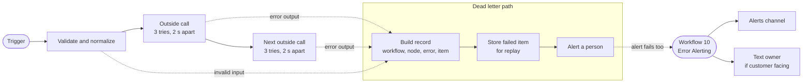
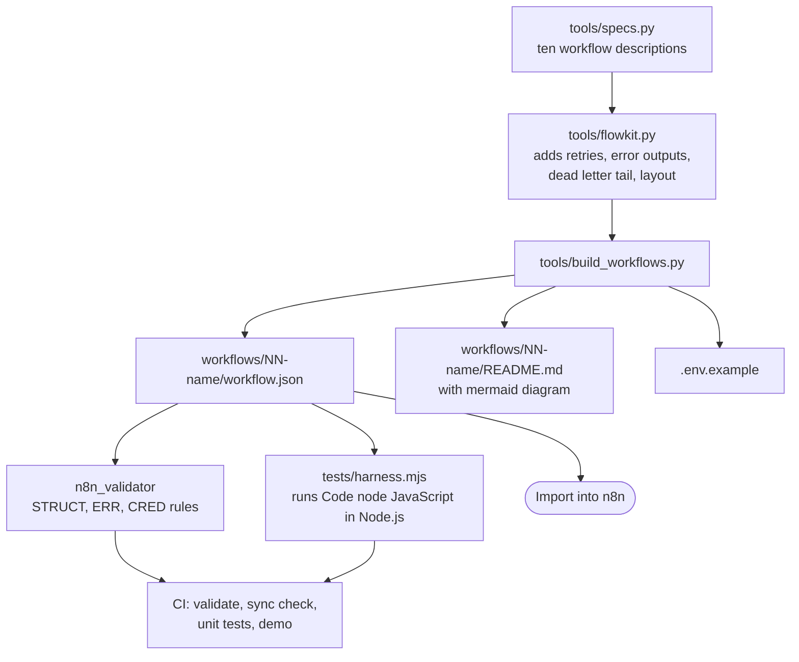

# n8n-workflow-library

Most shared n8n workflows are happy path only: the first time an API times out, a lead or an invoice reminder vanishes and nobody knows.
Exported workflows also tend to carry a pasted token somewhere, which makes them unsafe to share.

## What it does

Ten importable n8n workflows for service businesses, each built on the same reliability pattern, plus a Python validator that enforces that pattern in CI.

| # | Workflow | Trigger | What it does |
| --- | --- | --- | --- |
| 01 | [Lead Intake](workflows/01-lead-intake/) | Webhook | Clean the lead, upsert it in the CRM, text the lead, tell the office |
| 02 | [Missed Call Text Back](workflows/02-missed-call-text-back/) | Webhook | Text a caller you missed, at most once an hour |
| 03 | [Estimate Follow Up](workflows/03-estimate-follow-up/) | Schedule | Nudge unanswered estimates at 2, 5 and 10 days |
| 04 | [Invoice Reminder](workflows/04-invoice-reminder/) | Schedule | Four tier reminder ladder, final notices flagged to the owner |
| 05 | [Review Request](workflows/05-review-request/) | Webhook | Ask for a review only when the job is paid and complaint free |
| 06 | [Daily Owner Digest](workflows/06-daily-owner-digest/) | Schedule | One evening email: leads, tomorrow's jobs, money owed |
| 07 | [New Hire Onboarding](workflows/07-new-hire-onboarding/) | Webhook | HR record, dated checklist, welcome email, team note |
| 08 | [Form to CRM](workflows/08-form-to-crm/) | Webhook | Map form fields, drop spam, update or create contact, open a deal |
| 09 | [Calendar Sync](workflows/09-calendar-sync/) | Schedule | Push job changes to the crew calendar every 15 minutes |
| 10 | [Error Alerting](workflows/10-error-alerting/) | Error Trigger | Catch any failed execution from the other nine and tell a person |

Each folder holds `workflow.json` (import this), a `README.md` with a mermaid diagram, node table, configuration and tuning notes, and `sample.json` with synthetic input.

The workflows are vendor neutral. Every outside call is a generic HTTP Request node pointed at a URL from an environment variable, with a named Header Auth credential. Swap in a native node after import if you like; keep the retry and error settings when you do.

## The pattern every workflow follows



1. **Retry.** Nodes that call outside systems have `retryOnFail: true`, `maxTries: 3`, `waitBetweenTries: 2000`.
2. **Error branch.** The same nodes have `onError: "continueErrorOutput"`. A failed item leaves through the extra output and the rest of the run carries on.
3. **Dead letter path.** Failed items are shaped into a record (workflow, failed node, error, original item), posted to a dead letter store, and a person is told.
4. **Last resort.** `settings.errorWorkflow` points at workflow 10, which runs when an execution fails outright, including when the dead letter alert itself cannot be sent.

## Architecture



The JSON files are the product and import as they are. The generator exists so the shared tail and the docs cannot drift between ten files; a test fails if the files on disk differ from what the specs produce.

## The validator

Standard library Python only, nothing to install.

| Family | Rules | Checks |
| --- | --- | --- |
| STRUCT | 01 to 08 | Top level shape, node fields, unique ids and names, connections point at real nodes, a trigger exists and reaches every node, `executionOrder` is v1, ships inactive with no pinned data, expression braces balance |
| ERR | 01 to 05 | Outside calls retry within n8n's limits, have a wired error output, every error output reaches a dead letter node that stores the item, the workflow names an error workflow |
| CRED | 01 to 03 | Credential blocks are references (id and name only), no string matches a known key or token shape, sensitive fields such as `Authorization` hold expressions and not literals |

`python -m n8n_validator rules` prints all sixteen. Findings never echo a matched secret.

Conventions the ERR rules rely on: a node counts as an outside call if its type is in `IO_NODE_TYPES` (see `n8n_validator/checks.py`) or it has credentials, and a dead letter node is one whose name starts with `Dead letter`.

## Run it

```bash
python -m n8n_validator validate workflows
python -m n8n_validator trace workflows/01-lead-intake
```

Needs Python 3.10 or newer. To use a workflow, import its `workflow.json` into n8n and follow the folder's README. Import workflow 10 first so you have its id for the others. `.env.example` lists the environment variables the workflows read.

## Tests

```bash
python -m unittest discover -s tests
```

51 tests in three files:

- `tests/test_validator.py`: every rule passing and failing, by damaging copies of a good workflow.
- `tests/test_library.py`: the ten workflows validate clean, each has retries, an error branch and a three node dead letter path, generated files match the specs, `.env.example` matches what the workflows read, sample data is synthetic.
- `tests/test_code_nodes.py`: runs the JavaScript from the Code nodes in Node.js through a small shim and checks the business rules (follow up cadence, reminder tiers, review eligibility, spam checks and so on). Also syntax checks every Code node and every JSON body expression. These tests are skipped if Node.js is not installed.

CI (`.github/workflows/ci.yml`) runs the validator, the sync check, the tests and the demo.

## Demo

```bash
python demo/run_demo.py
```

Offline, no n8n, no keys. It validates the library, prints where a failed item goes in two workflows, then breaks a copy of Lead Intake in twelve realistic ways (retries off, error output unplugged, a Bearer header pasted from a cURL import, an API key in a URL, pinned test data left in, and so on) and shows the validator catching each one. Captured output is in [demo/output.txt](demo/output.txt). Excerpt:

```text
CAUGHT  Authorization header pasted in from a cURL import  (expects CRED-03: ...)
        CRED-03 [Upsert CRM contact]: parameters.headerParameters.parameters[0] sets 'Authorization' to a literal value
        CRED-02 [Upsert CRM contact]: looks like a literal Bearer token: Bearer...
```

## Where this pattern runs

The retry, error output, dead letter and alert pattern is drawn from automation that runs two small service companies day to day, where a dropped lead or a silent failure costs real work. The workflows here are clean rewrites with synthetic data and generic endpoints; nothing was copied from those systems.

## Limitations

- **Not executed inside n8n in this repository.** The JSON follows the current export format (`nodes`, `connections` keyed by node name, `settings.executionOrder: "v1"`, node level `retryOnFail`, `maxTries`, `waitBetweenTries`, `onError`) and the Code node JavaScript is run by the tests in plain Node.js, but no test imports the files into a live n8n instance. Import and run each one once with its sample input before you activate it.
- **Generic endpoints.** The HTTP nodes assume simple REST shapes such as `POST /contacts/upsert` returning `{ "id": ... }` and searches returning `{ "results": [...] }`. Your CRM, SMS gateway, accounting and calendar APIs will differ; expect to edit URLs and bodies, or replace nodes with native ones.
- **`$env` access.** The workflows read URLs and business details from environment variables. n8n Cloud and instances with `N8N_BLOCK_ENV_ACCESS_IN_NODE=true` do not allow that; replace the `$env` expressions with n8n Variables or fixed values there.
- **The dead letter store is yours to provide.** `DEAD_LETTER_URL` can be anything that accepts a JSON POST (a table API, a queue, another webhook). Replaying stored items is manual.
- **Retries are short.** n8n caps node retries at 5 tries and 5 seconds apart, so the retry step covers blips, not long outages. Long outages end in the dead letter store.
- **At least once, not exactly once.** A node that times out after the remote system accepted the call can send twice on retry. Workflows pass a dedupe or external key where the pattern needs one, but the receiving API has to honour it.
- **Secret detection is pattern based.** The CRED rules catch common key shapes and literal values in sensitive fields. A secret with no recognisable shape in an innocently named field will get through.
- **Validator conventions.** The ERR rules depend on the `Dead letter` name prefix and a fixed list of outside call node types. A workflow that handles errors a different way will fail validation even if it is sound.
- **No compliance logic.** Texting customers has consent and quiet hour rules that vary by place. The messages include an opt out line where it matters, but compliance is on you.

License: MIT, see the LICENSE file.
