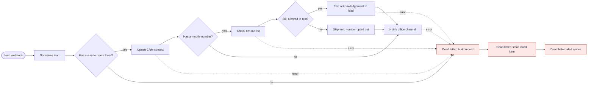

# 01 Lead Intake

Takes a new lead from any source that can post JSON (website, ad form, answering service), cleans it up, saves it to the CRM, texts the lead so they know a person will call, and tells the office. A lead with no phone and no email is not dropped. It goes to the dead letter store so someone can look at it.

## Trigger

Webhook, `POST /webhook/lead-intake`. Responds immediately so slow downstream systems never make the form hang.

## Flow

Dashed lines are error outputs. Shaded nodes are the dead letter path.



## Nodes

| Node | Type | Retries | What it does |
| --- | --- | --- | --- |
| Lead webhook | Webhook | n/a | Receives the lead as JSON. |
| Normalize lead | Code | n/a | Trims fields, converts the phone to E.164, lowercases the email and builds a dedupe key. |
| Has a way to reach them? | If | n/a | No phone and no email means nobody can follow up. Those go to the dead letter path. |
| Upsert CRM contact | HTTP Request | 3 tries, 2000 ms apart | Creates or updates the contact and opens a lead record. |
| Has a mobile number? | If | n/a | Email only leads skip the text. |
| Check opt-out list | HTTP Request | 3 tries, 2000 ms apart | Asks the opt-out store whether this number replied STOP. If the store cannot be reached the text is not sent; the item goes to the dead letter path. |
| Still allowed to text? | If | n/a | Yes only when the store has no opt-out for the number. |
| Skip text: number opted out | Edit Fields (Set) | n/a | No text is sent. The reason stays on the item so the execution shows why. |
| Text acknowledgement to lead | HTTP Request | 3 tries, 2000 ms apart | Lets the lead know the request landed and a person will call. |
| Notify office channel | HTTP Request | 3 tries, 2000 ms apart | Posts the lead to the office chat so it gets claimed. |
| Dead letter: build record | Edit Fields (Set) | n/a | Shapes one record per failed item: which workflow, which node, why, and the item itself so it can be replayed. |
| Dead letter: store failed item | HTTP Request | 3 tries, 2000 ms apart | Stores the record. Continues even if the store is down so the alert below still goes out. |
| Dead letter: alert owner | HTTP Request | 3 tries, 2000 ms apart | Posts to the alerts channel. If this also fails the execution fails and the error workflow takes over. |

## Error handling

1. Every node that calls an outside system retries before it gives up.
2. An item that still fails leaves through the node's error output. Other items in the same run carry on.
3. `Dead letter: build record` records the workflow, the failed node, the error and the item itself.
4. `Dead letter: store failed item` posts that record to `DEAD_LETTER_URL` so it can be fixed and replayed.
5. The last dead letter node tells a person. If that also fails, the execution fails and the error workflow named in `settings.errorWorkflow` (workflow 10) takes over.

Error paths in this workflow:

```text
Upsert CRM contact (x3, 2000 ms apart) =error=> Dead letter: build record -> Dead letter: store failed item -> Dead letter: alert owner
Check opt-out list (x3, 2000 ms apart) =error=> Dead letter: build record -> Dead letter: store failed item -> Dead letter: alert owner
Text acknowledgement to lead (x3, 2000 ms apart) =error=> Dead letter: build record -> Dead letter: store failed item -> Dead letter: alert owner
Notify office channel (x3, 2000 ms apart) =error=> Dead letter: build record -> Dead letter: store failed item -> Dead letter: alert owner
```

## Configuration

| Environment variable | Purpose |
| --- | --- |
| `BUSINESS_NAME` | Name used in customer facing messages |
| `BUSINESS_PHONE` | Number that texts are sent from |
| `CRM_BASE_URL` | Base URL of the CRM REST API |
| `SMS_API_URL` | Endpoint that sends one text message |
| `TEAM_CHAT_WEBHOOK_URL` | Incoming webhook for the office channel |
| `ALERT_WEBHOOK_URL` | Incoming webhook for the alerts channel |
| `OPT_OUT_URL` | Base URL of the SMS opt-out store |
| `DEAD_LETTER_URL` | Endpoint that stores failed items for replay |

Credentials to create in n8n (type: Header Auth) and select on the nodes after import: `CRM API`, `Opt-out store`, `SMS gateway`, `Dead letter store`.
The JSON holds only a placeholder id and the credential name. No secret is stored in the file.

## Sample webhook body

Synthetic data, also saved as `sample.json`.

```json
{
  "name": "Alex Sample",
  "phone": "(555) 555-0142",
  "email": "Alex.Sample@Example.com",
  "service": "bathroom remodel",
  "message": "Looking for a quote on a tub to shower conversion.",
  "source": "website"
}
```

## Import

1. In the n8n editor open a new workflow, then the three dot menu > Import from File, and pick `workflow.json`. On a self hosted server `n8n import:workflow --input=workflow.json` does the same.
2. Create the Header Auth credentials named above and select them on the nodes that show a warning.
3. Set the environment variables above on the n8n host. n8n 2.x blocks `$env` in nodes by default, so also set `N8N_BLOCK_ENV_ACCESS_IN_NODE=false`. On a plan that has n8n Variables you can instead replace each `$env.NAME` with `$vars.NAME`; the main README explains the trade off.
4. Under Settings > Error workflow pick the imported `Error Alerting` workflow (the file ships with the placeholder `REPLACE_WITH_ERROR_WORKFLOW_ID`).
5. Run it once with the sample input, then publish it (activate on n8n 1.x).

## Tuning notes

- The CRM call is an upsert keyed on `dedupeKey` (phone or email plus the date) so a double submit does not create two contacts.
- Leads without a mobile number skip the text and still reach the office channel. So do leads whose number is on the opt-out list (workflow 11 maintains it).
- Change the acknowledgement wording in `Text acknowledgement to lead`.
