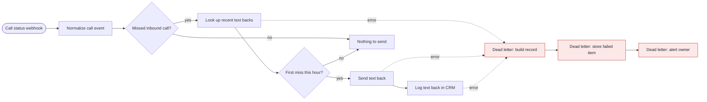

# 02 Missed Call Text Back

When an inbound call is not answered, texts the caller within seconds so they do not move on to the next company in the search results. Sends at most one text per caller per hour and logs it on the contact.

## Trigger

Webhook, `POST /webhook/missed-call`. Point your phone provider's call status callback at it.

## Flow

Dashed lines are error outputs. Shaded nodes are the dead letter path.



## Nodes

| Node | Type | Retries | What it does |
| --- | --- | --- | --- |
| Call status webhook | Webhook | n/a | Receives one event per finished call. |
| Normalize call event | Code | n/a | Decides whether this call was a missed inbound call from a textable number. |
| Missed inbound call? | If | n/a | Answered and outbound calls stop here. |
| Look up recent text backs | HTTP Request | 3 tries, 2000 ms apart | Asks the CRM whether this caller was already texted in the last hour. |
| First miss this hour? | If | n/a | Stops repeat dialers from getting a text for every attempt. |
| Send text back | HTTP Request | 3 tries, 2000 ms apart | Texts the caller. |
| Log text back in CRM | HTTP Request | 3 tries, 2000 ms apart | Records the text so the one hour check works and the office can see it. |
| Nothing to send | No Operation | n/a | Answered call, outbound call, or caller already texted. |
| Dead letter: build record | Edit Fields (Set) | n/a | Shapes one record per failed item: which workflow, which node, why, and the item itself so it can be replayed. |
| Dead letter: store failed item | HTTP Request | 3 tries, 2000 ms apart | Stores the record. Continues even if the store is down so the alert below still goes out. |
| Dead letter: alert owner | HTTP Request | 3 tries, 2000 ms apart | Posts to the alerts channel. If this also fails the execution fails and the error workflow takes over. |

## Error handling

1. Every node that calls an outside system retries before it gives up.
2. An item that still fails leaves through the node's error output. Other items in the same run carry on.
3. `Dead letter: build record` records the workflow, the failed node, the error and the item itself.
4. `Dead letter: store failed item` posts that record to `DEAD_LETTER_URL` so it can be fixed and replayed.
5. The last dead letter node tells a person. If that also fails, the execution fails and the error workflow named in `settings.errorWorkflow` (workflow 10) takes over.

Error paths in this workflow:

```text
Look up recent text backs (x3, 2000 ms apart) =error=> Dead letter: build record -> Dead letter: store failed item -> Dead letter: alert owner
Send text back (x3, 2000 ms apart) =error=> Dead letter: build record -> Dead letter: store failed item -> Dead letter: alert owner
Log text back in CRM (x3, 2000 ms apart) =error=> Dead letter: build record -> Dead letter: store failed item -> Dead letter: alert owner
```

## Configuration

| Environment variable | Purpose |
| --- | --- |
| `BUSINESS_NAME` | Name used in customer facing messages |
| `BUSINESS_PHONE` | Number that texts are sent from |
| `CRM_BASE_URL` | Base URL of the CRM REST API |
| `SMS_API_URL` | Endpoint that sends one text message |
| `ALERT_WEBHOOK_URL` | Incoming webhook for the alerts channel |
| `DEAD_LETTER_URL` | Endpoint that stores failed items for replay |

Credentials to create in n8n (type: Header Auth) and select on the nodes after import: `CRM API`, `SMS gateway`, `Dead letter store`.
The JSON holds only a placeholder id and the credential name. No secret is stored in the file.

## Sample webhook body

Synthetic data, also saved as `sample.json`.

```json
{
  "callId": "call-0001",
  "from": "+15555550143",
  "to": "+15555550100",
  "direction": "inbound",
  "status": "no-answer"
}
```

## Import

1. In n8n choose Import from File and pick `workflow.json`.
2. Select your credentials on the nodes that show a warning.
3. Under Settings > Error workflow pick the imported `Error Alerting` workflow (the file ships with the placeholder `REPLACE_WITH_ERROR_WORKFLOW_ID`).
4. Run it once with the sample input, then activate it.

## Tuning notes

- `MISSED` in `Normalize call event` lists the call statuses that count as missed.
- The after hours window (before 8, after 18, workflow timezone) only changes the wording.
- The one hour window is `sinceMinutes` in `Look up recent text backs`.
