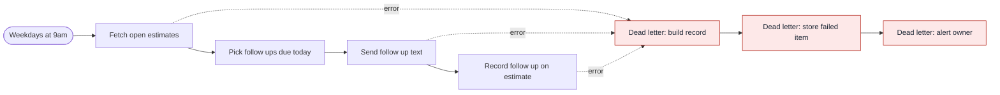

# 03 Estimate Follow Up

Estimates that were sent and never answered get three polite nudges, 2, 5 and 10 days after sending. The workflow reads open estimates each weekday morning, works out which nudge is due, sends it and records it on the estimate so nobody is nudged twice for the same step.

## Trigger

Schedule, weekdays at 09:00 (`0 9 * * 1-5`, workflow timezone).

## Flow

Dashed lines are error outputs. Shaded nodes are the dead letter path.



## Nodes

| Node | Type | Retries | What it does |
| --- | --- | --- | --- |
| Weekdays at 9am | Schedule Trigger | n/a | Runs once each weekday morning. |
| Fetch open estimates | HTTP Request | 3 tries, 2000 ms apart | Reads estimates that are sent and not yet accepted or declined. |
| Pick follow ups due today | Code | n/a | Emits one item per estimate whose next nudge is due. |
| Send follow up text | HTTP Request | 3 tries, 2000 ms apart | Sends the nudge for this step. |
| Record follow up on estimate | HTTP Request | 3 tries, 2000 ms apart | Bumps the follow up counter so the same step is not sent again. |
| Dead letter: build record | Edit Fields (Set) | n/a | Shapes one record per failed item: which workflow, which node, why, and the item itself so it can be replayed. |
| Dead letter: store failed item | HTTP Request | 3 tries, 2000 ms apart | Stores the record. Continues even if the store is down so the alert below still goes out. |
| Dead letter: alert owner | HTTP Request | 3 tries, 2000 ms apart | Posts to the alerts channel. If this also fails the execution fails and the error workflow takes over. |

## Error handling

1. Every node that calls an outside system retries before it gives up.
2. An item that still fails leaves through the node's error output. Other items in the same run carry on.
3. `Dead letter: build record` records the workflow, the failed node, the error and the item itself.
4. `Dead letter: store failed item` posts that record to `DEAD_LETTER_URL` so it can be fixed and replayed.
5. The last dead letter node tells a person. If that also fails, the execution fails and the error workflow named in `settings.errorWorkflow` (workflow 10) takes over.

Error paths in this workflow:

```text
Fetch open estimates (x3, 2000 ms apart) =error=> Dead letter: build record -> Dead letter: store failed item -> Dead letter: alert owner
Send follow up text (x3, 2000 ms apart) =error=> Dead letter: build record -> Dead letter: store failed item -> Dead letter: alert owner
Record follow up on estimate (x3, 2000 ms apart) =error=> Dead letter: build record -> Dead letter: store failed item -> Dead letter: alert owner
```

## Configuration

| Environment variable | Purpose |
| --- | --- |
| `BUSINESS_NAME` | Name used in customer facing messages |
| `BUSINESS_PHONE` | Number that texts are sent from |
| `CRM_BASE_URL` | Base URL of the CRM REST API |
| `SMS_API_URL` | Endpoint that sends one text message |
| `ALERT_WEBHOOK_URL` | Incoming webhook for the alerts channel |
| `DEAD_LETTER_URL` | Endpoint that stores failed items for replay |

Credentials to create in n8n (type: Header Auth) and select on the nodes after import: `CRM API`, `SMS gateway`, `Dead letter store`.
The JSON holds only a placeholder id and the credential name. No secret is stored in the file.

## Sample response from `Fetch open estimates`

Synthetic data, also saved as `sample.json`.

```json
{
  "results": [
    {
      "id": "est-1001",
      "customerName": "Alex Sample",
      "phone": "+15555550142",
      "total": 4800,
      "sentAt": "2030-01-06T15:00:00Z",
      "followUpsSent": 0,
      "optedOut": false
    }
  ]
}
```

## Import

1. In the n8n editor open a new workflow, then the three dot menu > Import from File, and pick `workflow.json`. On a self hosted server `n8n import:workflow --input=workflow.json` does the same.
2. Create the Header Auth credentials named above and select them on the nodes that show a warning.
3. Set the environment variables above on the n8n host. n8n 2.x blocks `$env` in nodes by default, so also set `N8N_BLOCK_ENV_ACCESS_IN_NODE=false` or replace the `$env` expressions with n8n Variables.
4. Under Settings > Error workflow pick the imported `Error Alerting` workflow (the file ships with the placeholder `REPLACE_WITH_ERROR_WORKFLOW_ID`).
5. Run it once with the sample input, then publish it (activate on n8n 1.x).

## Tuning notes

- `CADENCE` in `Pick follow ups due today` holds the day offsets.
- A step missed over a weekend is sent on the next weekday because the check is 'at least N days'.
- The third message says it is the last one. Keep that promise if you add steps.
