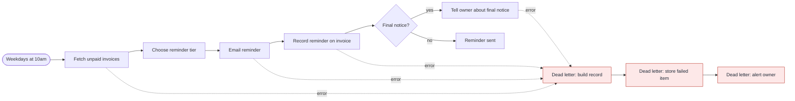

# 04 Invoice Reminder

Chases unpaid invoices on a fixed ladder: a heads up 3 days before the due date, a gentle reminder once overdue, a firm one at 7 days and a final notice at 21 days. Each tier is sent once per invoice. Final notices are also flagged to the owner so a person makes the next call.

## Trigger

Schedule, weekdays at 10:00 (`0 10 * * 1-5`, workflow timezone).

## Flow

Dashed lines are error outputs. Shaded nodes are the dead letter path.



## Nodes

| Node | Type | Retries | What it does |
| --- | --- | --- | --- |
| Weekdays at 10am | Schedule Trigger | n/a | Runs once each weekday. |
| Fetch unpaid invoices | HTTP Request | 3 tries, 2000 ms apart | Reads invoices with a balance. |
| Choose reminder tier | Code | n/a | Picks the highest tier each invoice has reached and not yet received. |
| Email reminder | HTTP Request | 3 tries, 2000 ms apart | Sends the reminder for the chosen tier. |
| Record reminder on invoice | HTTP Request | 3 tries, 2000 ms apart | Stores the tier so it is not sent twice. |
| Final notice? | If | n/a | Only final notices need a person. |
| Tell owner about final notice | HTTP Request | 3 tries, 2000 ms apart | Flags the invoice for a phone call. |
| Reminder sent | No Operation | n/a | Earlier tiers end here. |
| Dead letter: build record | Edit Fields (Set) | n/a | Shapes one record per failed item: which workflow, which node, why, and the item itself so it can be replayed. |
| Dead letter: store failed item | HTTP Request | 3 tries, 2000 ms apart | Stores the record. Continues even if the store is down so the alert below still goes out. |
| Dead letter: alert owner | HTTP Request | 3 tries, 2000 ms apart | Posts to the alerts channel. If this also fails the execution fails and the error workflow takes over. |

## Error handling

1. Every node that calls an outside system retries before it gives up.
2. An item that still fails leaves through the node's error output. Other items in the same run carry on.
3. `Dead letter: build record` records the workflow, the failed node, the error and the item itself.
4. `Dead letter: store failed item` posts that record to `DEAD_LETTER_URL` so it can be fixed and replayed.
5. The last dead letter node tells a person. If that also fails, the execution fails and the error workflow named in `settings.errorWorkflow` (workflow 10) takes over.

Error paths in this workflow:

```text
Fetch unpaid invoices (x3, 2000 ms apart) =error=> Dead letter: build record -> Dead letter: store failed item -> Dead letter: alert owner
Email reminder (x3, 2000 ms apart) =error=> Dead letter: build record -> Dead letter: store failed item -> Dead letter: alert owner
Record reminder on invoice (x3, 2000 ms apart) =error=> Dead letter: build record -> Dead letter: store failed item -> Dead letter: alert owner
Tell owner about final notice (x3, 2000 ms apart) =error=> Dead letter: build record -> Dead letter: store failed item -> Dead letter: alert owner
```

## Configuration

| Environment variable | Purpose |
| --- | --- |
| `BUSINESS_NAME` | Name used in customer facing messages |
| `ACCOUNTING_API_URL` | Base URL of the invoicing API |
| `EMAIL_API_URL` | Endpoint that sends one email |
| `TEAM_CHAT_WEBHOOK_URL` | Incoming webhook for the office channel |
| `ALERT_WEBHOOK_URL` | Incoming webhook for the alerts channel |
| `DEAD_LETTER_URL` | Endpoint that stores failed items for replay |

Credentials to create in n8n (type: Header Auth) and select on the nodes after import: `Accounting API`, `Email API`, `Dead letter store`.
The JSON holds only a placeholder id and the credential name. No secret is stored in the file.

## Sample response from `Fetch unpaid invoices`

Synthetic data, also saved as `sample.json`.

```json
{
  "results": [
    {
      "id": "inv-2001",
      "number": "2001",
      "customerName": "Alex Sample",
      "email": "alex.sample@example.com",
      "balance": 1250.0,
      "dueDate": "2030-01-10",
      "lastReminderTier": 0,
      "disputed": false
    }
  ]
}
```

## Import

1. In the n8n editor open a new workflow, then the three dot menu > Import from File, and pick `workflow.json`. On a self hosted server `n8n import:workflow --input=workflow.json` does the same.
2. Create the Header Auth credentials named above and select them on the nodes that show a warning.
3. Set the environment variables above on the n8n host. n8n 2.x blocks `$env` in nodes by default, so also set `N8N_BLOCK_ENV_ACCESS_IN_NODE=false` or replace the `$env` expressions with n8n Variables.
4. Under Settings > Error workflow pick the imported `Error Alerting` workflow (the file ships with the placeholder `REPLACE_WITH_ERROR_WORKFLOW_ID`).
5. Run it once with the sample input, then publish it (activate on n8n 1.x).

## Tuning notes

- `TIERS` in `Choose reminder tier` holds the ladder. Tiers only move up, never repeat.
- Disputed invoices are skipped entirely. Resolve those by phone.
- Add a payment link to the email body if your invoicing tool provides one per invoice.
