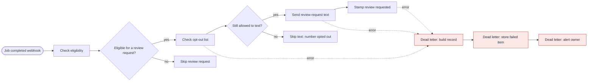

# 05 Review Request

Asks happy customers for a review right after the job closes, and only them. A job has to be paid, have no open complaint, the customer must not have been asked in the last 90 days, and the number must not be on the SMS opt-out list.

## Trigger

Webhook, `POST /webhook/job-completed`. Fire it from the job system when a job is marked complete.

## Flow

Dashed lines are error outputs. Shaded nodes are the dead letter path.



## Nodes

| Node | Type | Retries | What it does |
| --- | --- | --- | --- |
| Job completed webhook | Webhook | n/a | Receives the finished job. |
| Check eligibility | Code | n/a | Applies the rules and records the reason when a job is skipped. |
| Eligible for a review request? | If | n/a | Skipped jobs end quietly. |
| Check opt-out list | HTTP Request | 3 tries, 2000 ms apart | Asks the opt-out store whether this number replied STOP. If the store cannot be reached the text is not sent; the item goes to the dead letter path. |
| Still allowed to text? | If | n/a | Yes only when the store has no opt-out for the number. |
| Skip text: number opted out | Edit Fields (Set) | n/a | No text is sent. The reason stays on the item so the execution shows why. |
| Send review request text | HTTP Request | 3 tries, 2000 ms apart | Sends the ask with the review link. |
| Stamp review requested | HTTP Request | 3 tries, 2000 ms apart | Stores the date so the cool down works. |
| Skip review request | No Operation | n/a | Not eligible. The reason is on the item. |
| Dead letter: build record | Edit Fields (Set) | n/a | Shapes one record per failed item: which workflow, which node, why, and the item itself so it can be replayed. |
| Dead letter: store failed item | HTTP Request | 3 tries, 2000 ms apart | Stores the record. Continues even if the store is down so the alert below still goes out. |
| Dead letter: alert owner | HTTP Request | 3 tries, 2000 ms apart | Posts to the alerts channel. If this also fails the execution fails and the error workflow takes over. |

## Error handling

1. Every node that calls an outside system retries before it gives up.
2. An item that still fails leaves through the node's error output. Other items in the same run carry on.
3. `Dead letter: build record` records the workflow, the failed node, the error and the item itself.
4. `Dead letter: store failed item` posts that record to `DEAD_LETTER_URL` so it can be fixed and replayed.
5. The last dead letter node tells a person. If that also fails, the execution fails and the error workflow named in `settings.errorWorkflow` (workflow 10) takes over.

Error paths in this workflow:

```text
Check opt-out list (x3, 2000 ms apart) =error=> Dead letter: build record -> Dead letter: store failed item -> Dead letter: alert owner
Send review request text (x3, 2000 ms apart) =error=> Dead letter: build record -> Dead letter: store failed item -> Dead letter: alert owner
Stamp review requested (x3, 2000 ms apart) =error=> Dead letter: build record -> Dead letter: store failed item -> Dead letter: alert owner
```

## Configuration

| Environment variable | Purpose |
| --- | --- |
| `BUSINESS_NAME` | Name used in customer facing messages |
| `BUSINESS_PHONE` | Number that texts are sent from |
| `REVIEW_LINK` | Public review page |
| `CRM_BASE_URL` | Base URL of the CRM REST API |
| `SMS_API_URL` | Endpoint that sends one text message |
| `ALERT_WEBHOOK_URL` | Incoming webhook for the alerts channel |
| `OPT_OUT_URL` | Base URL of the SMS opt-out store |
| `DEAD_LETTER_URL` | Endpoint that stores failed items for replay |

Credentials to create in n8n (type: Header Auth) and select on the nodes after import: `Opt-out store`, `SMS gateway`, `CRM API`, `Dead letter store`.
The JSON holds only a placeholder id and the credential name. No secret is stored in the file.

## Sample webhook body

Synthetic data, also saved as `sample.json`.

```json
{
  "jobId": "job-3001",
  "customerId": "cus-501",
  "customerName": "Alex Sample",
  "phone": "+15555550142",
  "paid": true,
  "openComplaint": false,
  "lastReviewRequestAt": null,
  "smsOptOut": false
}
```

## Import

1. In the n8n editor open a new workflow, then the three dot menu > Import from File, and pick `workflow.json`. On a self hosted server `n8n import:workflow --input=workflow.json` does the same.
2. Create the Header Auth credentials named above and select them on the nodes that show a warning.
3. Set the environment variables above on the n8n host. n8n 2.x blocks `$env` in nodes by default, so also set `N8N_BLOCK_ENV_ACCESS_IN_NODE=false`. On a plan that has n8n Variables you can instead replace each `$env.NAME` with `$vars.NAME`; the main README explains the trade off.
4. Under Settings > Error workflow pick the imported `Error Alerting` workflow (the file ships with the placeholder `REPLACE_WITH_ERROR_WORKFLOW_ID`).
5. Run it once with the sample input, then publish it (activate on n8n 1.x).

## Tuning notes

- `COOL_DOWN_DAYS` in `Check eligibility` sets how often one customer can be asked.
- Skipped jobs carry a `reason` field. Open the execution to see why a job was skipped.
- Two opt-out sources are honoured: the `smsOptOut` flag in the webhook body and the opt-out store that workflow 11 maintains.
- Do not offer anything in exchange for a review. Most review sites prohibit it.
