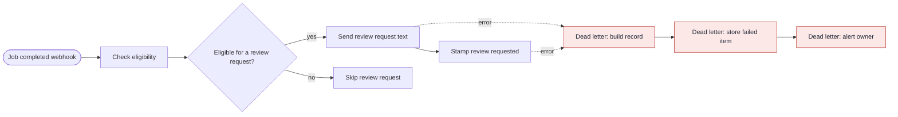

# 05 Review Request

Asks happy customers for a review right after the job closes, and only them. A job has to be paid, have no open complaint, and the customer must not have been asked in the last 90 days.

## Trigger

Webhook, `POST /webhook/job-completed`. Fire it from the job system when a job is marked complete.

## Flow

Dashed lines are error outputs. Shaded nodes are the dead letter path.



## Nodes

| Node | Type | Retries | What it does |
| --- | --- | --- | --- |
| Job completed webhook | Webhook | n/a | Receives the finished job. |
| Check eligibility | Code | n/a | Applies the rules and records the reason when a job is skipped. |
| Eligible for a review request? | If | n/a | Skipped jobs end quietly. |
| Send review request text | HTTP Request | 3 tries, 2000 ms apart | Sends the ask with the review link. |
| Stamp review requested | HTTP Request | 3 tries, 2000 ms apart | Stores the date so the cool down works. |
| Skip review request | No Operation | n/a | Not eligible. The reason is on the item. |
| Dead letter: build record | Edit Fields (Set) | n/a | Shapes one record per failed item: which workflow, which node, why, and the item itself so it can be replayed. |
| Dead letter: store failed item | HTTP Request | 3 tries, 2000 ms apart | Stores the record. Continues even if the store is down so the alert below still goes out. |
| Dead letter: alert owner | HTTP Request | 3 tries, 2000 ms apart | Posts to the alerts channel. If this also fails the execution fails and the error workflow takes over. |

## Error handling

1. Every node that calls an outside system retries before it gives up.
2. An item that still fails leaves through the node's error output. Other items in the same run carry on.
3. `Dead letter: build record` records the workflow, the failed node, the error and the item itself.
4. `Dead letter: store failed item` posts that record to `DEAD_LETTER_URL` so it can be fixed and replayed.
5. The last dead letter node tells a person. If that also fails, the execution fails and the error workflow named in `settings.errorWorkflow` (workflow 10) takes over.

Error paths in this workflow:

```text
Send review request text (x3, 2000 ms apart) =error=> Dead letter: build record -> Dead letter: store failed item -> Dead letter: alert owner
Stamp review requested (x3, 2000 ms apart) =error=> Dead letter: build record -> Dead letter: store failed item -> Dead letter: alert owner
```

## Configuration

| Environment variable | Purpose |
| --- | --- |
| `BUSINESS_NAME` | Name used in customer facing messages |
| `BUSINESS_PHONE` | Number that texts are sent from |
| `REVIEW_LINK` | Public review page |
| `CRM_BASE_URL` | Base URL of the CRM REST API |
| `SMS_API_URL` | Endpoint that sends one text message |
| `ALERT_WEBHOOK_URL` | Incoming webhook for the alerts channel |
| `DEAD_LETTER_URL` | Endpoint that stores failed items for replay |

Credentials to create in n8n (type: Header Auth) and select on the nodes after import: `SMS gateway`, `CRM API`, `Dead letter store`.
The JSON holds only a placeholder id and the credential name. No secret is stored in the file.

## Sample webhook body

Synthetic data, also saved as `sample.json`.

```json
{
  "jobId": "job-3001",
  "customerId": "cus-501",
  "customerName": "Alex Sample",
  "phone": "+15555550142",
  "paid": true,
  "openComplaint": false,
  "lastReviewRequestAt": null,
  "smsOptOut": false
}
```

## Import

1. In n8n choose Import from File and pick `workflow.json`.
2. Select your credentials on the nodes that show a warning.
3. Under Settings > Error workflow pick the imported `Error Alerting` workflow (the file ships with the placeholder `REPLACE_WITH_ERROR_WORKFLOW_ID`).
4. Run it once with the sample input, then activate it.

## Tuning notes

- `COOL_DOWN_DAYS` in `Check eligibility` sets how often one customer can be asked.
- Skipped jobs carry a `reason` field. Open the execution to see why a job was skipped.
- Do not offer anything in exchange for a review. Most review sites prohibit it.
