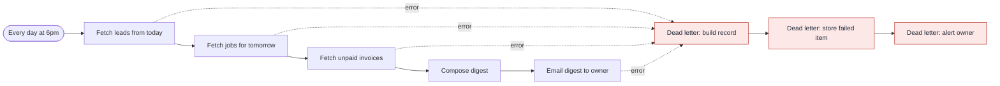

# 06 Daily Owner Digest

One email at the end of the day with the numbers an owner checks anyway: leads that came in today, jobs on the board for tomorrow, and money still owed. It replaces opening three tools.

## Trigger

Schedule, every day at 18:00 (`0 18 * * *`, workflow timezone).

## Flow

Dashed lines are error outputs. Shaded nodes are the dead letter path.



## Nodes

| Node | Type | Retries | What it does |
| --- | --- | --- | --- |
| Every day at 6pm | Schedule Trigger | n/a | Runs once each evening. |
| Fetch leads from today | HTTP Request | 3 tries, 2000 ms apart | Leads created since midnight. |
| Fetch jobs for tomorrow | HTTP Request | 3 tries, 2000 ms apart | Jobs scheduled for tomorrow. |
| Fetch unpaid invoices | HTTP Request | 3 tries, 2000 ms apart | Invoices with a balance. |
| Compose digest | Code | n/a | Builds one plain text email from the three responses. |
| Email digest to owner | HTTP Request | 3 tries, 2000 ms apart | Sends the digest. |
| Dead letter: build record | Edit Fields (Set) | n/a | Shapes one record per failed item: which workflow, which node, why, and the item itself so it can be replayed. |
| Dead letter: store failed item | HTTP Request | 3 tries, 2000 ms apart | Stores the record. Continues even if the store is down so the alert below still goes out. |
| Dead letter: alert owner | HTTP Request | 3 tries, 2000 ms apart | Posts to the alerts channel. If this also fails the execution fails and the error workflow takes over. |

## Error handling

1. Every node that calls an outside system retries before it gives up.
2. An item that still fails leaves through the node's error output. Other items in the same run carry on.
3. `Dead letter: build record` records the workflow, the failed node, the error and the item itself.
4. `Dead letter: store failed item` posts that record to `DEAD_LETTER_URL` so it can be fixed and replayed.
5. The last dead letter node tells a person. If that also fails, the execution fails and the error workflow named in `settings.errorWorkflow` (workflow 10) takes over.

Error paths in this workflow:

```text
Fetch leads from today (x3, 2000 ms apart) =error=> Dead letter: build record -> Dead letter: store failed item -> Dead letter: alert owner
Fetch jobs for tomorrow (x3, 2000 ms apart) =error=> Dead letter: build record -> Dead letter: store failed item -> Dead letter: alert owner
Fetch unpaid invoices (x3, 2000 ms apart) =error=> Dead letter: build record -> Dead letter: store failed item -> Dead letter: alert owner
Email digest to owner (x3, 2000 ms apart) =error=> Dead letter: build record -> Dead letter: store failed item -> Dead letter: alert owner
```

## Configuration

| Environment variable | Purpose |
| --- | --- |
| `OWNER_EMAIL` | Where the digest and last resort alerts go |
| `CRM_BASE_URL` | Base URL of the CRM REST API |
| `ACCOUNTING_API_URL` | Base URL of the invoicing API |
| `EMAIL_API_URL` | Endpoint that sends one email |
| `ALERT_WEBHOOK_URL` | Incoming webhook for the alerts channel |
| `DEAD_LETTER_URL` | Endpoint that stores failed items for replay |

Credentials to create in n8n (type: Header Auth) and select on the nodes after import: `CRM API`, `Accounting API`, `Email API`, `Dead letter store`.
The JSON holds only a placeholder id and the credential name. No secret is stored in the file.

## Sample responses the three fetch nodes expect

Synthetic data, also saved as `sample.json`.

```json
{
  "leads": {
    "results": [
      {
        "name": "Alex Sample",
        "service": "bathroom remodel",
        "source": "website"
      }
    ]
  },
  "jobs": {
    "results": [
      {
        "startTime": "08:00",
        "title": "Tub to shower conversion",
        "crew": "Crew A"
      }
    ]
  },
  "invoices": {
    "results": [
      {
        "number": "2001",
        "balance": 1250.0,
        "dueDate": "2030-01-10"
      }
    ]
  }
}
```

## Import

1. In the n8n editor open a new workflow, then the three dot menu > Import from File, and pick `workflow.json`. On a self hosted server `n8n import:workflow --input=workflow.json` does the same.
2. Create the Header Auth credentials named above and select them on the nodes that show a warning.
3. Set the environment variables above on the n8n host. n8n 2.x blocks `$env` in nodes by default, so also set `N8N_BLOCK_ENV_ACCESS_IN_NODE=false` or replace the `$env` expressions with n8n Variables.
4. Under Settings > Error workflow pick the imported `Error Alerting` workflow (the file ships with the placeholder `REPLACE_WITH_ERROR_WORKFLOW_ID`).
5. Run it once with the sample input, then publish it (activate on n8n 1.x).

## Tuning notes

- If any one fetch fails after retries the digest is not sent with a hole in it. The failure goes to the dead letter path and the alerts channel instead.
- Lists are capped at 10 lines each so the email stays readable on a phone.
- The second and third fetch run once even if an earlier response is split into many items (`executeOnce`).
