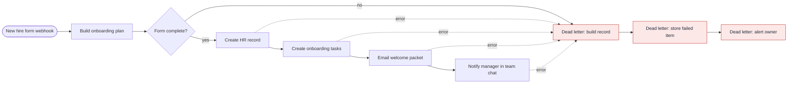

# 07 New Hire Onboarding

Turns one submitted new hire form into the same checklist every time: an HR record, dated tasks for the office and the manager, a welcome email with first day details, and a note in the team chat. No new hire starts without a tablet login or safety orientation because someone forgot.

## Trigger

Webhook, `POST /webhook/new-hire`. Connect it to the hiring form.

## Flow

Dashed lines are error outputs. Shaded nodes are the dead letter path.



## Nodes

| Node | Type | Retries | What it does |
| --- | --- | --- | --- |
| New hire form webhook | Webhook | n/a | Receives the submitted form. |
| Build onboarding plan | Code | n/a | Validates the form and expands the checklist template into dated tasks. |
| Form complete? | If | n/a | Incomplete forms go to the dead letter path. |
| Create HR record | HTTP Request | 3 tries, 2000 ms apart | Creates the employee record. |
| Create onboarding tasks | HTTP Request | 3 tries, 2000 ms apart | Creates every checklist task in one call. |
| Email welcome packet | HTTP Request | 3 tries, 2000 ms apart | Sends first day details to the new hire. |
| Notify manager in team chat | HTTP Request | 3 tries, 2000 ms apart | Tells the team who is starting and when. |
| Dead letter: build record | Edit Fields (Set) | n/a | Shapes one record per failed item: which workflow, which node, why, and the item itself so it can be replayed. |
| Dead letter: store failed item | HTTP Request | 3 tries, 2000 ms apart | Stores the record. Continues even if the store is down so the alert below still goes out. |
| Dead letter: alert owner | HTTP Request | 3 tries, 2000 ms apart | Posts to the alerts channel. If this also fails the execution fails and the error workflow takes over. |

## Error handling

1. Every node that calls an outside system retries before it gives up.
2. An item that still fails leaves through the node's error output. Other items in the same run carry on.
3. `Dead letter: build record` records the workflow, the failed node, the error and the item itself.
4. `Dead letter: store failed item` posts that record to `DEAD_LETTER_URL` so it can be fixed and replayed.
5. The last dead letter node tells a person. If that also fails, the execution fails and the error workflow named in `settings.errorWorkflow` (workflow 10) takes over.

Error paths in this workflow:

```text
Create HR record (x3, 2000 ms apart) =error=> Dead letter: build record -> Dead letter: store failed item -> Dead letter: alert owner
Create onboarding tasks (x3, 2000 ms apart) =error=> Dead letter: build record -> Dead letter: store failed item -> Dead letter: alert owner
Email welcome packet (x3, 2000 ms apart) =error=> Dead letter: build record -> Dead letter: store failed item -> Dead letter: alert owner
Notify manager in team chat (x3, 2000 ms apart) =error=> Dead letter: build record -> Dead letter: store failed item -> Dead letter: alert owner
```

## Configuration

| Environment variable | Purpose |
| --- | --- |
| `BUSINESS_NAME` | Name used in customer facing messages |
| `HR_API_URL` | Base URL of the HR or task system API |
| `EMAIL_API_URL` | Endpoint that sends one email |
| `TEAM_CHAT_WEBHOOK_URL` | Incoming webhook for the office channel |
| `ALERT_WEBHOOK_URL` | Incoming webhook for the alerts channel |
| `DEAD_LETTER_URL` | Endpoint that stores failed items for replay |

Credentials to create in n8n (type: Header Auth) and select on the nodes after import: `HR system API`, `Email API`, `Dead letter store`.
The JSON holds only a placeholder id and the credential name. No secret is stored in the file.

## Sample webhook body

Synthetic data, also saved as `sample.json`.

```json
{
  "name": "Jordan Example",
  "email": "jordan.example@example.com",
  "role": "field technician",
  "startDate": "2030-02-03",
  "managerEmail": "manager@example.com"
}
```

## Import

1. In n8n choose Import from File and pick `workflow.json`.
2. Select your credentials on the nodes that show a warning.
3. Under Settings > Error workflow pick the imported `Error Alerting` workflow (the file ships with the placeholder `REPLACE_WITH_ERROR_WORKFLOW_ID`).
4. Run it once with the sample input, then activate it.

## Tuning notes

- `TEMPLATE` in `Build onboarding plan` is the checklist. `dueInDays` is relative to the start date.
- Tasks with a `roles` list are only created for those roles.
- An incomplete form goes to the dead letter path instead of creating half a record.
