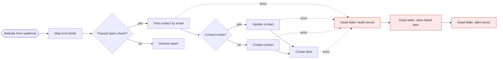

# 08 Form to CRM

Website contact forms usually end up as an email someone has to retype. This maps the form fields to CRM fields, drops obvious bot submissions, updates the contact if the email is already known or creates it if not, and opens a deal so the request shows up in the pipeline.

## Trigger

Webhook, `POST /webhook/website-form`. Works with any form tool that can post JSON.

## Flow

Dashed lines are error outputs. Shaded nodes are the dead letter path.



## Nodes

| Node | Type | Retries | What it does |
| --- | --- | --- | --- |
| Website form webhook | Webhook | n/a | Receives the form submission. |
| Map form fields | Code | n/a | Renames fields, cleans phone and email, and runs the spam checks. |
| Passed spam check? | If | n/a | Honeypot filled, bad email or links in the message. |
| Find contact by email | HTTP Request | 3 tries, 2000 ms apart | Looks for an existing contact. |
| Contact exists? | If | n/a | Chooses update or create. |
| Update contact | HTTP Request | 3 tries, 2000 ms apart | Refreshes phone and last contact date on the existing record. |
| Create contact | HTTP Request | 3 tries, 2000 ms apart | Creates the contact. |
| Create deal | HTTP Request | 3 tries, 2000 ms apart | Opens a deal linked to the contact. |
| Discard spam | No Operation | n/a | Bot submissions end here on purpose. They are not errors. |
| Dead letter: build record | Edit Fields (Set) | n/a | Shapes one record per failed item: which workflow, which node, why, and the item itself so it can be replayed. |
| Dead letter: store failed item | HTTP Request | 3 tries, 2000 ms apart | Stores the record. Continues even if the store is down so the alert below still goes out. |
| Dead letter: alert owner | HTTP Request | 3 tries, 2000 ms apart | Posts to the alerts channel. If this also fails the execution fails and the error workflow takes over. |

## Error handling

1. Every node that calls an outside system retries before it gives up.
2. An item that still fails leaves through the node's error output. Other items in the same run carry on.
3. `Dead letter: build record` records the workflow, the failed node, the error and the item itself.
4. `Dead letter: store failed item` posts that record to `DEAD_LETTER_URL` so it can be fixed and replayed.
5. The last dead letter node tells a person. If that also fails, the execution fails and the error workflow named in `settings.errorWorkflow` (workflow 10) takes over.

Error paths in this workflow:

```text
Find contact by email (x3, 2000 ms apart) =error=> Dead letter: build record -> Dead letter: store failed item -> Dead letter: alert owner
Update contact (x3, 2000 ms apart) =error=> Dead letter: build record -> Dead letter: store failed item -> Dead letter: alert owner
Create contact (x3, 2000 ms apart) =error=> Dead letter: build record -> Dead letter: store failed item -> Dead letter: alert owner
Create deal (x3, 2000 ms apart) =error=> Dead letter: build record -> Dead letter: store failed item -> Dead letter: alert owner
```

## Configuration

| Environment variable | Purpose |
| --- | --- |
| `CRM_BASE_URL` | Base URL of the CRM REST API |
| `ALERT_WEBHOOK_URL` | Incoming webhook for the alerts channel |
| `DEAD_LETTER_URL` | Endpoint that stores failed items for replay |

Credentials to create in n8n (type: Header Auth) and select on the nodes after import: `CRM API`, `Dead letter store`.
The JSON holds only a placeholder id and the credential name. No secret is stored in the file.

## Sample webhook body

Synthetic data, also saved as `sample.json`.

```json
{
  "full_name": "Alex Sample",
  "email_address": "alex.sample@example.com",
  "phone_number": "555-555-0142",
  "project_type": "kitchen",
  "details": "New counters and backsplash.",
  "website": "",
  "page_url": "https://www.example.com/contact"
}
```

## Import

1. In the n8n editor open a new workflow, then the three dot menu > Import from File, and pick `workflow.json`. On a self hosted server `n8n import:workflow --input=workflow.json` does the same.
2. Create the Header Auth credentials named above and select them on the nodes that show a warning.
3. Set the environment variables above on the n8n host. n8n 2.x blocks `$env` in nodes by default, so also set `N8N_BLOCK_ENV_ACCESS_IN_NODE=false` or replace the `$env` expressions with n8n Variables.
4. Under Settings > Error workflow pick the imported `Error Alerting` workflow (the file ships with the placeholder `REPLACE_WITH_ERROR_WORKFLOW_ID`).
5. Run it once with the sample input, then publish it (activate on n8n 1.x).

## Tuning notes

- `website` is a honeypot field. Hide it with CSS; real people leave it empty.
- Rename the keys in `FIELD_MAP` to match your form tool.
- Find then update or create is two calls. If your CRM has a real upsert endpoint, use it as workflow 01 does.
