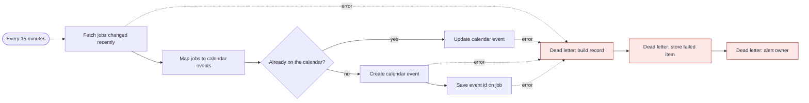

# 09 Calendar Sync

Keeps the shared crew calendar in step with the job system. Every 15 minutes it reads jobs that changed, creates a calendar event for new ones, updates moved ones, and marks cancelled ones in the title. The job system is the source of truth; nothing flows back from the calendar.

## Trigger

Schedule, every 15 minutes (`*/15 * * * *`).

## Flow

Dashed lines are error outputs. Shaded nodes are the dead letter path.



## Nodes

| Node | Type | Retries | What it does |
| --- | --- | --- | --- |
| Every 15 minutes | Schedule Trigger | n/a | Polls for changes. |
| Fetch jobs changed recently | HTTP Request | 3 tries, 2000 ms apart | Jobs updated in the last 20 minutes. |
| Map jobs to calendar events | Code | n/a | Builds one calendar event payload per scheduled job. |
| Already on the calendar? | If | n/a | Chooses update or create. |
| Update calendar event | HTTP Request | 3 tries, 2000 ms apart | Replaces the event with the current job details. |
| Create calendar event | HTTP Request | 3 tries, 2000 ms apart | Creates the event. |
| Save event id on job | HTTP Request | 3 tries, 2000 ms apart | Stores the new event id so the next change is an update. |
| Dead letter: build record | Edit Fields (Set) | n/a | Shapes one record per failed item: which workflow, which node, why, and the item itself so it can be replayed. |
| Dead letter: store failed item | HTTP Request | 3 tries, 2000 ms apart | Stores the record. Continues even if the store is down so the alert below still goes out. |
| Dead letter: alert owner | HTTP Request | 3 tries, 2000 ms apart | Posts to the alerts channel. If this also fails the execution fails and the error workflow takes over. |

## Error handling

1. Every node that calls an outside system retries before it gives up.
2. An item that still fails leaves through the node's error output. Other items in the same run carry on.
3. `Dead letter: build record` records the workflow, the failed node, the error and the item itself.
4. `Dead letter: store failed item` posts that record to `DEAD_LETTER_URL` so it can be fixed and replayed.
5. The last dead letter node tells a person. If that also fails, the execution fails and the error workflow named in `settings.errorWorkflow` (workflow 10) takes over.

Error paths in this workflow:

```text
Fetch jobs changed recently (x3, 2000 ms apart) =error=> Dead letter: build record -> Dead letter: store failed item -> Dead letter: alert owner
Update calendar event (x3, 2000 ms apart) =error=> Dead letter: build record -> Dead letter: store failed item -> Dead letter: alert owner
Create calendar event (x3, 2000 ms apart) =error=> Dead letter: build record -> Dead letter: store failed item -> Dead letter: alert owner
Save event id on job (x3, 2000 ms apart) =error=> Dead letter: build record -> Dead letter: store failed item -> Dead letter: alert owner
```

## Configuration

| Environment variable | Purpose |
| --- | --- |
| `CRM_BASE_URL` | Base URL of the CRM REST API |
| `CALENDAR_API_URL` | Base URL of the calendar API |
| `ALERT_WEBHOOK_URL` | Incoming webhook for the alerts channel |
| `DEAD_LETTER_URL` | Endpoint that stores failed items for replay |

Credentials to create in n8n (type: Header Auth) and select on the nodes after import: `CRM API`, `Calendar API`, `Dead letter store`.
The JSON holds only a placeholder id and the credential name. No secret is stored in the file.

## Sample response from `Fetch jobs changed recently`

Synthetic data, also saved as `sample.json`.

```json
{
  "results": [
    {
      "id": "job-3001",
      "title": "Tub to shower conversion",
      "customerName": "Alex Sample",
      "status": "scheduled",
      "scheduledStart": "2030-02-04T13:00:00Z",
      "scheduledEnd": null,
      "siteAddress": "100 Example Street",
      "crew": "Crew A",
      "calendarEventId": null
    }
  ]
}
```

## Import

1. In the n8n editor open a new workflow, then the three dot menu > Import from File, and pick `workflow.json`. On a self hosted server `n8n import:workflow --input=workflow.json` does the same.
2. Create the Header Auth credentials named above and select them on the nodes that show a warning.
3. Set the environment variables above on the n8n host. n8n 2.x blocks `$env` in nodes by default, so also set `N8N_BLOCK_ENV_ACCESS_IN_NODE=false` or replace the `$env` expressions with n8n Variables.
4. Under Settings > Error workflow pick the imported `Error Alerting` workflow (the file ships with the placeholder `REPLACE_WITH_ERROR_WORKFLOW_ID`).
5. Run it once with the sample input, then publish it (activate on n8n 1.x).

## Tuning notes

- The fetch window is 20 minutes on a 15 minute schedule so a slow run does not leave a gap. Updates are idempotent, so the overlap is harmless.
- Jobs without an end time get a 2 hour block (`DEFAULT_HOURS`).
- `externalKey` lets a calendar API reject a duplicate create if the event id was not saved the first time.
