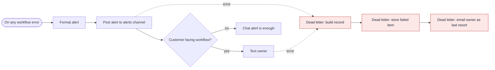

# 10 Error Alerting

The last line of defence for the other nine. Set it as the error workflow on every workflow and any failed execution, including a trigger that could not start, becomes a message in the alerts channel with the workflow, the node and a link to the execution. Failures in customer facing workflows also text the owner. If the alert itself cannot be delivered it is stored and emailed instead.

## Trigger

Error Trigger. n8n runs this workflow when a workflow that names it under Settings > Error workflow fails.

## Flow

Dashed lines are error outputs. Shaded nodes are the dead letter path.



## Nodes

| Node | Type | Retries | What it does |
| --- | --- | --- | --- |
| On any workflow error | Error Trigger | n/a | Receives the failed execution. |
| Format alert | Code | n/a | Flattens the error data into one readable line and decides whether it is urgent. |
| Post alert to alerts channel | HTTP Request | 3 tries, 2000 ms apart | Posts the alert. |
| Customer facing workflow? | If | n/a | Only failures that cost a customer contact wake someone up. |
| Text owner | HTTP Request | 3 tries, 2000 ms apart | Texts the owner a short version. |
| Chat alert is enough | No Operation | n/a | Back office failures wait for working hours. |
| Dead letter: build record | Edit Fields (Set) | n/a | Shapes one record per failed item: which workflow, which node, why, and the item itself so it can be replayed. |
| Dead letter: store failed item | HTTP Request | 3 tries, 2000 ms apart | Stores the record. Continues even if the store is down so the alert below still goes out. |
| Dead letter: email owner as last resort | HTTP Request | 3 tries, 2000 ms apart | Chat or SMS is down. Email is the fallback channel. |

## Error handling

1. Every node that calls an outside system retries before it gives up.
2. An item that still fails leaves through the node's error output. Other items in the same run carry on.
3. `Dead letter: build record` records the workflow, the failed node, the error and the item itself.
4. `Dead letter: store failed item` posts that record to `DEAD_LETTER_URL` so it can be fixed and replayed.
5. The last dead letter node tells a person. If that also fails, the execution fails and there is nothing further to fall back to; n8n keeps the failed execution in its own log.

Error paths in this workflow:

```text
Post alert to alerts channel (x3, 2000 ms apart) =error=> Dead letter: build record -> Dead letter: store failed item -> Dead letter: email owner as last resort
Text owner (x3, 2000 ms apart) =error=> Dead letter: build record -> Dead letter: store failed item -> Dead letter: email owner as last resort
```

## Configuration

| Environment variable | Purpose |
| --- | --- |
| `BUSINESS_PHONE` | Number that texts are sent from |
| `OWNER_PHONE` | Where urgent alerts are texted |
| `OWNER_EMAIL` | Where the digest and last resort alerts go |
| `SMS_API_URL` | Endpoint that sends one text message |
| `EMAIL_API_URL` | Endpoint that sends one email |
| `ALERT_WEBHOOK_URL` | Incoming webhook for the alerts channel |
| `DEAD_LETTER_URL` | Endpoint that stores failed items for replay |

Credentials to create in n8n (type: Header Auth) and select on the nodes after import: `SMS gateway`, `Dead letter store`, `Email API`.
The JSON holds only a placeholder id and the credential name. No secret is stored in the file.

## Sample Error Trigger item

Synthetic data, also saved as `sample.json`.

```json
{
  "execution": {
    "id": "231",
    "url": "https://n8n.example.com/execution/231",
    "error": {
      "message": "The service refused the connection"
    },
    "lastNodeExecuted": "Dead letter: alert owner",
    "mode": "trigger"
  },
  "workflow": {
    "id": "1",
    "name": "Lead Intake"
  }
}
```

## Import

1. In n8n choose Import from File and pick `workflow.json`.
2. Select your credentials on the nodes that show a warning.
3. Save, activate, and copy this workflow's id into `settings.errorWorkflow` of the other nine (Settings > Error workflow in the editor).

## Tuning notes

- `URGENT` in `Format alert` lists the workflows that should also text the owner.
- This workflow does not name an error workflow of its own. That would loop.
- Import this workflow first and copy its id into the other nine.
