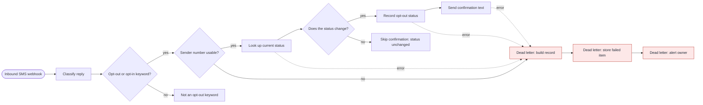

# 11 SMS Opt-Out

Handles the reply to every 'Reply STOP to opt out' line the other workflows send. An inbound text that is exactly STOP, STOPALL, UNSUBSCRIBE, CANCEL, END or QUIT puts the number on the opt-out list; START or UNSTOP takes it off again. The sender gets one confirmation when the status changes and none for a repeat. Workflows 01, 02, 03 and 05 read the same list before they text anyone.

## Trigger

Webhook, `POST /webhook/inbound-sms`. Point your SMS provider's inbound message callback at it.

## Flow

Dashed lines are error outputs. Shaded nodes are the dead letter path.



## Nodes

| Node | Type | Retries | What it does |
| --- | --- | --- | --- |
| Inbound SMS webhook | Webhook | n/a | Receives one inbound text message. |
| Classify reply | Code | n/a | Decides whether the message is an opt-out keyword, an opt-in keyword or neither. |
| Opt-out or opt-in keyword? | If | n/a | Ordinary replies stop here. |
| Sender number usable? | If | n/a | A keyword from a number that cannot be read goes to the dead letter path so a person can act on it. |
| Look up current status | HTTP Request | 3 tries, 2000 ms apart | Reads the number's current entry so a repeat keyword does not trigger a second confirmation. |
| Does the status change? | If | n/a | Yes when a STOP arrives for a number that is not opted out, or a START for one that is. |
| Record opt-out status | HTTP Request | 3 tries, 2000 ms apart | Creates or updates the entry the other workflows read before texting. |
| Send confirmation text | HTTP Request | 3 tries, 2000 ms apart | Confirms the change to the sender, once. |
| Not an opt-out keyword | No Operation | n/a | Ordinary replies are not this workflow's job. |
| Skip confirmation: status unchanged | Edit Fields (Set) | n/a | A repeat STOP or START. Nothing is written and nothing is sent. |
| Dead letter: build record | Edit Fields (Set) | n/a | Shapes one record per failed item: which workflow, which node, why, and the item itself so it can be replayed. |
| Dead letter: store failed item | HTTP Request | 3 tries, 2000 ms apart | Stores the record. Continues even if the store is down so the alert below still goes out. |
| Dead letter: alert owner | HTTP Request | 3 tries, 2000 ms apart | Posts to the alerts channel. If this also fails the execution fails and the error workflow takes over. |

## Error handling

1. Every node that calls an outside system retries before it gives up.
2. An item that still fails leaves through the node's error output. Other items in the same run carry on.
3. `Dead letter: build record` records the workflow, the failed node, the error and the item itself.
4. `Dead letter: store failed item` posts that record to `DEAD_LETTER_URL` so it can be fixed and replayed.
5. The last dead letter node tells a person. If that also fails, the execution fails and the error workflow named in `settings.errorWorkflow` (workflow 10) takes over.

Error paths in this workflow:

```text
Look up current status (x3, 2000 ms apart) =error=> Dead letter: build record -> Dead letter: store failed item -> Dead letter: alert owner
Record opt-out status (x3, 2000 ms apart) =error=> Dead letter: build record -> Dead letter: store failed item -> Dead letter: alert owner
Send confirmation text (x3, 2000 ms apart) =error=> Dead letter: build record -> Dead letter: store failed item -> Dead letter: alert owner
```

## Configuration

| Environment variable | Purpose |
| --- | --- |
| `BUSINESS_NAME` | Name used in customer facing messages |
| `BUSINESS_PHONE` | Number that texts are sent from |
| `SMS_API_URL` | Endpoint that sends one text message |
| `ALERT_WEBHOOK_URL` | Incoming webhook for the alerts channel |
| `OPT_OUT_URL` | Base URL of the SMS opt-out store |
| `DEAD_LETTER_URL` | Endpoint that stores failed items for replay |

Credentials to create in n8n (type: Header Auth) and select on the nodes after import: `Opt-out store`, `SMS gateway`, `Dead letter store`.
The JSON holds only a placeholder id and the credential name. No secret is stored in the file.

## Sample webhook body

Synthetic data, also saved as `sample.json`.

```json
{
  "messageId": "msg-0001",
  "from": "+15555550142",
  "to": "+15555550100",
  "text": " Stop "
}
```

## Import

1. In the n8n editor open a new workflow, then the three dot menu > Import from File, and pick `workflow.json`. On a self hosted server `n8n import:workflow --input=workflow.json` does the same.
2. Create the Header Auth credentials named above and select them on the nodes that show a warning.
3. Set the environment variables above on the n8n host. n8n 2.x blocks `$env` in nodes by default, so also set `N8N_BLOCK_ENV_ACCESS_IN_NODE=false`. On a plan that has n8n Variables you can instead replace each `$env.NAME` with `$vars.NAME`; the main README explains the trade off.
4. Under Settings > Error workflow pick the imported `Error Alerting` workflow (the file ships with the placeholder `REPLACE_WITH_ERROR_WORKFLOW_ID`).
5. Run it once with the sample input, then publish it (activate on n8n 1.x).

## Tuning notes

- `OPT_OUT` and `OPT_IN` in `Classify reply` hold the keywords. The whole message has to be the keyword; case, spaces and punctuation are ignored, so `stop.` and `Stop All` count and `please stop calling` does not. Add your own words if customers write them.
- The workflow expects `from` and `text` in the webhook body. Rename them in `Classify reply` to match your provider.
- The store contract is two calls: `POST {OPT_OUT_URL}/search` with `{ phone }` returns `{ results: [...] }` (empty when the number may be texted), and `POST {OPT_OUT_URL}` with `{ phone, optedOut }` creates or updates the entry. An entry with `optedOut: false` is treated as not opted out.
- Many SMS providers and carriers act on STOP themselves and send their own confirmation. If yours does, delete `Send confirmation text` and keep the rest so the list the other workflows read stays current.
- Messages that are not a keyword end at `Not an opt-out keyword`. Route that output to your own inbox or chat handling if you want replies to reach a person.
